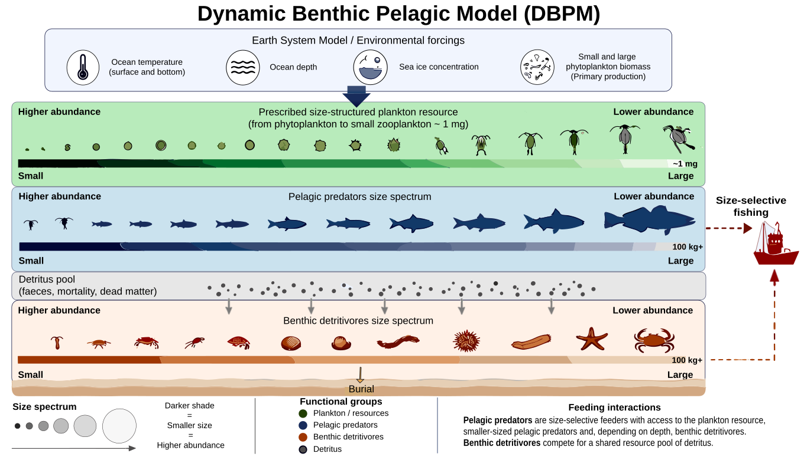

# dbpmr

R implementation of the Dynamic Benthic Pelagic Model (DBPM) with spatial size-spectrum capabilities.



*Schematic of the Dynamic Benthic-Pelagic Size Spectrum Model (DBPM): environmental inputs (top left)
drive the size-structured dynamics of pelagic predators and benthic detritivores, shaping biomass flows,
fish production, and ecosystem responses.*

## Installation

Installing from source compiles the bundled C engine, so a **C toolchain** is
required (Rtools on Windows, Xcode command-line tools on macOS, `r-base-dev` on
Debian/Ubuntu). Install straight from GitHub — note the package lives in the
`dbpmr/` sub-directory of the repository:

```r
# install.packages("remotes")
remotes::install_github(
  "Benthic-Pelagic-Size-Spectrum-Model/spatial-dbpm",
  subdir = "dbpmr"
)
```

See the [repository README](https://github.com/Benthic-Pelagic-Size-Spectrum-Model/spatial-dbpm#installation)
for local-clone installation and full system requirements.

## Quick start

A minimal, aspatial (0-D) coupled benthic–pelagic run with one pelagic and one
benthic species, reading the results back and plotting the final pelagic size
spectrum. Output files are written under a new `MyRun/` directory.

```r
library(dbpmr)

setwd(tempdir())   # the model writes output files to the working directory

# 1. Configure the run and the mass/time grid
run  <- Setup.Run("MyRun", no_pelagic = 1, no_benthic = 1,
                  spatial_dim = 0, coupled_flag = TRUE, diff_method = 1)
grid <- Setup.Grid(run, tmax = 10)          # integrate for 10 years

# 2. Configure the plankton resource, the two species and the detritus pool
plankton <- Setup.Plankton(run, filename = "plankton")
pelagic  <- Setup.Pelagic(run,  filename = "fish")
benthic  <- Setup.Benthic(run,  filename = "benthos")
detritus <- Setup.Detritus(run, filename = "detritus")

# 3. Run the simulation (calls the C engine; writes output under MyRun/)
files <- SizeSpectrum(run, grid, plankton, pelagic, benthic, detritus)

# 4. Read the pelagic results back and plot the final size spectrum
fish <- Read.In("MyRun", "fish")
snap <- Extract.Time(fish, time = max(fish@trange))
Plot.Spectrum(snap, type = "l",
              xlab = "log body mass", ylab = "log abundance",
              main = "Pelagic size spectrum")
```

See `vignette("dbpmr")` for a fuller walk-through.

## Forcing inputs (Earth System Model variables)

DBPM is driven by outputs from an Earth System Model (ESM; e.g. GFDL-MOM6-COBALT2 in ISIMIP3a/FishMIP,
monthly). These raw variables are processed into the model's forcing — the plankton size spectrum,
temperature effects, and detritus/export supply:

| ESM variable | dims | units | used for |
|---|---|---|---|
| `phyc` — total phytoplankton carbon | 3D (lon, lat, depth, time) | mol m⁻³ | plankton size-spectrum **intercept & slope**; vertical biomass weights |
| `phypico` — picophytoplankton carbon | 3D | mol m⁻³ | small-vs-large phyto split → spectrum **slope** |
| `thetao` — ocean temperature | 3D | °C | pelagic (water-column / experienced) temperature effect |
| `tob` — sea-floor temperature | 2D | °C | benthic temperature effect |
| `tos` — sea-surface temperature | 2D | °C | surface temperature effect; export-ratio formula |
| `intpp` — integrated primary production | 2D | mol m⁻² s⁻¹ | export-ratio denominator |
| `expc-bot` — carbon export flux to seafloor | 2D | mol m⁻² s⁻¹ | export ratio → benthic detritus supply |
| `deptho` — ocean depth (bathymetry) | 2D static | m | depth channel / pelagic-benthic coupling |
| `thkcello` — layer thickness | 3D static | m | weights for vertical integration of the 3D fields |
| `siconc` — sea-ice concentration | 2D | % | sea-ice gate on fishing effort (gridded runs only) |

Plus cell **area** (m²) for aggregating per-cell densities. Derivations: `intercept, slope` from
`GetPPIntSlope(phyc, phypico)`; export ratio ≈ `expc-bot / intpp`; temperature effects from `thetao` /
`tob`. **Note:** the depth-resolved (3D) `phyc`/`phypico`/`thetao` are needed for the vertically
biomass-weighted method; the standard method can instead use the ESM's vertically-integrated
`phyc-vint`/`phypico-vint` (mol m⁻²) with surface `tos`.

## Engine options (environment variables)

A couple of optional engine behaviours are controlled by environment variables, read by the
C engine at the start of a run (set them with `Sys.setenv(...)` before `SizeSpectrum()`):

| Variable | Default | Effect |
|---|---|---|
| `PEL_IMM_FRAC` | `0` (off) | **Connectivity/immigration recruitment floor** (pelagic only). When `> 0`, pelagic recruitment cannot fall below this fraction of the running peak of natural recruitment (frozen the instant the floor first binds) — a connectivity subsidy that rescues otherwise-collapsing cells. `0` skips the term entirely, so dynamics are unchanged. The gridded LME/regional runs use `0.15`. |
| `TEMP_ON_MORT` | `1` (on) | Whether temperature scales **background (natural) mortality** `mu_0`. With `1`, `mu_0 = mu_0_base × tempeff` for both groups. With `0`, temperature drives **feeding only** and `mu_0` is held at base — rationale: the model doesn't resolve metabolic maintenance/respiration, so a lone `mu_0 × tempeff` is an unbalanced "cost of warmth". |
| `FORCING_PERCELL` | `0` (off) | **Per-cell environmental forcing** for spatial runs (`spatial_dim ≥ 1`). When `1`, the `forcing_ts.txt` plugin reads **one row per cell per timestep** (`x*y` rows, x-outer/y-inner — the plankton `_ts` convention) so `pel_tempeff`/`ben_tempeff`/`sinking_rate` can vary across space; each cell then responds to its own temperature. `0` (default) reads one global row per timestep, applied to all cells — bit-identical to standard behaviour. |

```r
Sys.setenv(PEL_IMM_FRAC = "0.15")   # enable the connectivity floor at 15%
Sys.setenv(TEMP_ON_MORT = "0")      # temperature affects feeding only, not mortality
# ... then Setup.* and SizeSpectrum() as usual
```

**Note:** `TEMP_ON_MORT` defaults to *on*, so it affects baseline behaviour out of the box — set it
to `0` when comparing against runs that predate temperature-dependent mortality. `PEL_IMM_FRAC`
defaults to *off*, so leaving it unset reproduces the engine with no immigration floor.

## Legacy package name

This package was historically named `SizeSpectra` and has been renamed to `dbpmr` for consistency with DBPM usage.
